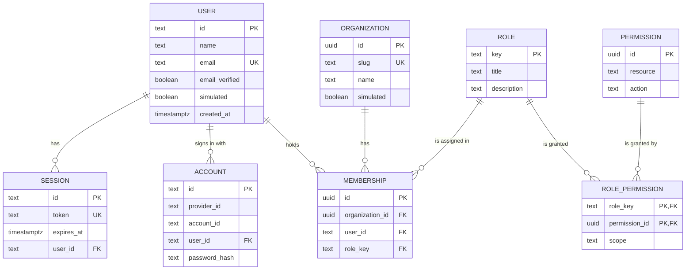

# Expathio — Phase 1 Database Architecture

**Status:** PROPOSED  
**Document type:** Technical proposal (database architecture)  
**Project:** Expathio  
**Proposed by:** Architecture and Quality session  
**Date:** 2026-11-17  
**Approval needed from:** Project owner. Business rules flagged in section 14 also need Product and Documentation.

This document is a proposal. It is not a decision. It becomes a decision only when the owner approves it, and then it is recorded in `docs/decisions/` (`CLAUDE.md`, section 5).

---

## 1. Summary

The database is the place where the organization's state is stored, and the rules for who may see and change that state depend on it (`05-TECHNICAL-ARCHITECTURE.md`, sections 5 and 10). Phase 1 must prove three things: a test account can log in, it is a member of an organization with a role, and the data of one organization cannot be seen from another.

We propose:

1. **One PostgreSQL database, one schema, shared by all organizations.** Every table that describes organizational activity carries an `organization_id`. This is the approved direction of ADR 0010 and `05`, section 10.
2. **Identity tables stay global.** Login accounts, sessions and the role catalog belong to no organization. A person can belong to more than one organization in the future.
3. **Isolation is enforced in three places:** the database (foreign keys that include `organization_id`, so a child row cannot point to a parent in another organization), the backend (every organization-scoped query takes the organization from the authenticated membership, not from the request body), and tests (integration tests that try to cross organizations and must fail).
4. **Permissions are data.** The permission matrix in `08-COMPANY.md`, section 6.1, is stored as rows in two tables (`permissions` and `role_permissions`). The rows are loaded from one versioned file in `shared/` by an idempotent seed, so they are reviewed in Git like code.
5. **Migrations are SQL files generated by Drizzle Kit, versioned in Git, applied by the deployment script before restart.** Each schema change is one migration file. Tests build the database from the migration files, not from the schema file, so the tests check what production will run.
6. **Integration tests run against PostgreSQL in Docker** (ADR 0016), with the PostgreSQL version pinned to match the phone once Q-007 is answered.

The draft schema on branch `feat/phase-1-backend-foundation` is close to this proposal. It has the right tables and the right unique constraints for one role per organization. It needs the changes listed in section 12 before it can be the base. This proposal does not change that branch.

**Cost:** R$ 0 per month for the Phase 1 setup (local Docker and the phone). Maintenance effort is low to moderate (see section 13).

---

## 2. Scope and inputs

**In scope:** the Phase 1 entities and their relations, ownership by organization, keys and constraints, the permission data, the test-account seed, the migration process and the database test process.

**Out of scope:** business tables of later phases (products, orders, cases, ledgers), the deployment script (Infrastructure and Operations), the hosting decision for Phase 4 (Q-006), the PostgreSQL version on the phone (Q-007, an input only).

**Documents read:** `CLAUDE.md` (sections 2, 5, 7, 8, 10, 11, 12), `docs/CURRENT_STATE.md`, `docs/05-TECHNICAL-ARCHITECTURE.md` (sections 5, 10, 12, 16, 19), `docs/06-ROADMAP.md` (section 4), `docs/08-COMPANY.md` (sections 5 and 6.1), `docs/02-BUSINESS-SIMULATION.md` (section 3), `docs/OPEN-QUESTIONS.md`, `docs/SESSION-STRUCTURE.md` (section 3.2).

**Decisions used:** ADR 0007 (one occupant per role), 0009 and 0027 (four roles and their titles), 0010 (isolation, statelessness, file storage, idempotent jobs), 0013 (NestJS and Drizzle), 0014 (pg-boss, better-auth, Vitest, Playwright), 0016 (three test levels, Docker PostgreSQL, migrations required), 0019 (folder layout: `server/db`, `shared/`), 0022 (test accounts only), 0023 (direct membership), 0024 (four business roles loaded as data), 0028 (e-mail login, simulated-data label).

**Draft used as input:** `server/db/schema.ts` and `server/db/migrations/0000_phase1_foundation.sql` on `feat/phase-1-backend-foundation` (commit `c270179`). Treated as one option, not as the base (section 12).

---

## 3. Terms used in this document

The word "account" has two meanings in the project's technical libraries. This document uses the following terms:

| Term in this document | Meaning | Table |
|---|---|---|
| **Account** (business sense, as in ADR 0022) | A person's login identity: name, e-mail, verification state | `user` (the name better-auth requires) |
| **Login method** | The credential used to sign in (for example, e-mail and password) | `account` (better-auth's table; it is not the business account) |
| **Organization** | A simulated company. Phase 1 has one: MONUMENT | `organizations` |
| **Membership** | The link between an account, an organization and a role (ADR 0023) | `memberships` |
| **Role** | A business role, for example Finance Assistant (ADR 0027) | `roles` |
| **Permission** | One action on one resource, for example "read orders" | `permissions` |
| **Role permission** | The grant of a permission to a role, with its scope | `role_permissions` |
| **Test account** | A fictional account created by the owner or the test setup (ADR 0022) | `user` with the simulated flag (section 9) |

The glossary (`docs/GLOSSARY.md`) does not define these table-level terms yet. A request for that is listed in section 14.

---

## 4. Demonstration: entities and relations

The diagram shows the eight Phase 1 tables. The gray tables are global (no organization). The blue table is organization-owned. The same diagram is also saved as an image: `docs/database/phase-1-entities.svg`.

Image version: `docs/database/phase-1-entities.svg`. Open it in a browser to see it outside an editor.

### Relations in words

| From | Relation | To | Meaning |
|---|---|---|---|
| Account | 1 to many | Session | An account can be signed in on several devices. |
| Account | 1 to many | Login method | An account can have one or more ways to sign in. Phase 1 uses e-mail and password. |
| Account | 1 to many | Membership | An account can belong to several organizations (future). Phase 1 creates one. |
| Organization | 1 to many | Membership | Every membership belongs to exactly one organization. |
| Role | 1 to many | Membership | A role has at most one occupant per organization (ADR 0007). |
| Role | 1 to many | Role permission | A role has several permission grants. |
| Permission | 1 to many | Role permission | A permission can be granted to several roles. |

---

## 5. How organization ownership is stored

### 5.1 Classification rule

Every table is in one of two groups. The rule is applied when a table is created.

- **Global table:** holds identity data, sessions, or reference data that is the same for every organization. It has no `organization_id`. Phase 1 global tables: `user`, `session`, `account`, `verification`, `roles`, `permissions`, `role_permissions`.
- **Organization-owned table:** holds data that describes what happens inside an organization. It must have `organization_id NOT NULL`. Phase 1 organization-owned table: `memberships`.

A later table that describes organizational activity (a product, an order, a case) is organization-owned by default. A table that is an exception needs a written reason in the migration's comment.

### 5.2 Composite keys for child tables

From Phase 2 on, a child row must not point to a parent row of another organization. Phase 1 has only one organization-owned table, so this rule has no effect on Phase 1 data, but the pattern must be fixed now:

- Each organization-owned parent table has a unique key on `(organization_id, id)`.
- Each organization-owned child table references the parent with a composite foreign key: `(organization_id, parent_id)` references `parent (organization_id, id)`.

The database then refuses a row whose `organization_id` does not match its parent. This does not depend on the application remembering the filter.

### 5.3 Enforcement in the backend

- The organization of a request comes from the membership of the authenticated account, not from a field the browser sends. The same rule applies to background jobs: a job carries the `organization_id` in its payload and checks it when it runs (ADR 0010, `05`, section 10).
- If a request names an organization in which the account has no membership, the answer is "not found", not "forbidden". This does not reveal that the organization exists.
- The repository functions for organization-owned tables require an `organizationId` argument. A query without it does not compile, so a missing filter is caught before it runs.
- The Phase 1 access rules (section 8) are checked by the backend on each request. Hiding a menu item is not access control (`CLAUDE.md`, section 10; ADR 0024).

### 5.4 Row-level security

PostgreSQL offers row-level security (RLS), which makes the database itself filter rows by a session variable. It is not part of this proposal. It is listed as Alternative B (section 13) and as an open question for the owner (section 14). Its main cost is that the table owner bypasses it unless it is forced, and that every connection and background job must set the variable correctly.

---

## 6. Phase 1 tables: purpose, owner and key

| Table | Group | Purpose | Primary key | Main unique constraints |
|---|---|---|---|---|
| `user` | Global | The account (person's login identity). | `id` (text, from better-auth) | `email` (case-insensitive, see 7.1) |
| `session` | Global | A signed-in session. | `id` (text) | `token` |
| `account` | Global | A login method, with the password hash. | `id` (text) | none beyond the key |
| `verification` | Global | Short-lived tokens (for example, e-mail confirmation). Not used in Phase 1 flows, kept because better-auth needs it. | `id` (text) | none |
| `organizations` | Organization (the owner itself) | The organization. Phase 1 has MONUMENT. | `id` (uuid) | `slug` |
| `roles` | Global catalog | The four business roles (ADR 0027). | `key` (text, stable, for example `finance-assistant`) | none beyond the key |
| `permissions` | Global catalog | Each resource and action that the system can check. | `id` (uuid) | `(resource, action)` |
| `role_permissions` | Global catalog | Which role has which permission, with its scope. | `(role_key, permission_id)` | the key itself |
| `memberships` | Organization-owned | The account's role in one organization. | `id` (uuid) | `(organization_id, user_id)`, `(organization_id, role_key)` |

Notes:

- better-auth requires the names and the text key type of `user`, `session`, `account` and `verification`. These four are kept as the draft has them. Our own tables use `uuid`, see section 7.2.
- `roles.key` is a stable text key, not a generated number, because the role is referred to by name in code and in the permission file.

---

## 7. Keys and constraints

### 7.1 Rules for all tables

- Every timestamp is `timestamptz` (timestamp with time zone). The draft uses `timestamp` without a zone. Phase 1 runs on one machine, but the simulation will show times in Brazil and may be used from other time zones; storing the zone removes that ambiguity.
- Every table has `created_at`. Tables whose rows change have `updated_at`.
- E-mail is unique without regard to upper and lower case. The index is on `lower(email)`. Without this, `Ana@x.test` and `ana@x.test` can be two accounts.
- Foreign keys are declared in the database, not only in code.
- Each enumerated value (scope, action) has a `CHECK` constraint with its allowed values, so an invalid value is refused by the database.

### 7.2 Keys

- Our own tables use `uuid` primary keys generated by the application (`crypto.randomUUID()`). This does not depend on the PostgreSQL version, which is still open (Q-007). The `gen_random_uuid()` function is available without extra extensions only from PostgreSQL 13 on.
- Stable reference keys are text: `roles.key`, and `organizations.slug` (for example `monument`) as a unique text value in addition to the `uuid`.
- better-auth tables keep their own text keys, as required by the library.

### 7.3 Constraints per table

**`organizations`**
- `id uuid` primary key.
- `slug text` unique, lowercase, `CHECK (slug ~ '^[a-z0-9-]+$')`.
- `name text` not null.
- `simulated boolean` not null, default `true`. The interface label for simulated data (ADR 0028) reads this value.
- `created_at timestamptz` not null.

**`roles`**
- `key text` primary key.
- `title text` not null, `description text` not null.

**`permissions`**
- `id uuid` primary key.
- `resource text` not null, `action text` not null, `CHECK (action IN ('read', 'change', 'request', 'decide'))`.
- Unique `(resource, action)`.

**`role_permissions`**
- Primary key `(role_key, permission_id)`.
- `role_key` references `roles.key`. `permission_id` references `permissions.id`.
- `scope text` not null, `CHECK (scope IN ('organization', 'own', 'case'))`. The meanings are in section 8.2.

**`memberships`**
- `id uuid` primary key.
- `organization_id uuid` not null, references `organizations.id`.
- `user_id text` not null, references `user.id`, `ON DELETE RESTRICT` (see 7.4).
- `role_key text` not null, references `roles.key`.
- Unique `(organization_id, user_id)`: one role per account per organization. This is an assumption to confirm (section 14).
- Unique `(organization_id, role_key)`: one occupant per role per organization (ADR 0007).
- `created_at timestamptz` not null.

**`user`**
- `id text` primary key (better-auth), `email` unique on `lower(email)`, `simulated boolean` not null default `true` (proposed, section 9).

### 7.4 Deletion rules

- A deleted account must not silently remove its membership history. `memberships.user_id` uses `ON DELETE RESTRICT`. The draft uses `CASCADE`. Phase 1 has no account deletion in the interface, so the difference is not visible yet. The choice is needed before Phase 4, when personal data rules apply (Q-002).
- `session` rows cascade with the account: a removed account must not keep a sign-in.

---

## 8. Permissions as data

### 8.1 Source of the permissions

`docs/08-COMPANY.md`, section 6.1, is the approved source (owner, 2026-11-06). The permission rows are written in one versioned file, `shared/access-rules.ts` (ADR 0024 names this file). The seed (section 9) copies that file into the `permissions` and `role_permissions` tables with upserts. The backend checks permission rows from the database when it authorizes a request. The rows and the file must agree; an integration test checks that they do (section 11).

Why not a single source? Two sources can drift, which is why the test exists. But the database is needed for two reasons in the future: Q-012 (adding a role by data), and tables that hold the scope of each grant. The file keeps every change reviewed in Git, because Phase 1 has no administration screen.

### 8.2 Vocabulary

| Field | Values | Meaning |
|---|---|---|
| `action` | `read` | See the record; no change |
| | `change` | Create or modify records of this kind |
| | `request` | Send a request that another role decides |
| | `decide` | Approve or reject a request sent by another role |
| `scope` | `organization` | All records of the organization of this kind |
| | `own` | Records the role's occupant owns (the definition is open; section 14) |
| | `case` | Records linked to a case the role works on (for example, the orders of a customer in an open case) |

The four actions are the minimum that `08-COMPANY.md`, section 6.1, needs. The draft's `access` text and `own_records_only` boolean cannot represent "request" and "decide" separately, or the case scope. That is why the draft is not used as the permission model (section 12).

### 8.3 Seed rows from `08-COMPANY.md`, section 6.1

Each row is one `role_permissions` entry. Resource names are proposals, in English, as the product uses English (`CLAUDE.md`, section 9).

| Resource | Operations Assistant | Customer Service Representative | Sales Support Assistant | Finance Assistant |
|---|---|---|---|---|
| `stock_levels` | change, organization | — | — | — |
| `orders` | read, organization | read, case | read, organization | read, organization |
| `fulfillment_queue` (queue and deliveries) | change, organization | — | — | — |
| `customer_cases` | — | change, own | — | — |
| `customer_contact_history` | — | read, organization | — | — |
| `refund_exchange_requests` | — | request, organization | — | decide (read and approve or reject), organization |
| `payment_refund_ledger` | — | — | — | change, organization |
| `revenue_report` | — | — | — | change, organization |
| `sales_dashboard` | read, organization | read, organization | read, organization | read, organization |
| `task_board` (own tasks) | change, own | change, own | change, own | change, own |
| `internal_messages` | read and send, own role | read and send, own role | read and send, own role | read and send, own role |
| `organization_documents` | read, organization | read, organization | read, organization | read, organization |
| `session_summary` | read, own role | read, own role | read, own role | read, own role |

Notes on the table:

- "Read" for Finance on refund requests is a separate row from "decide" in the proposal: a role that decides must also read. The matrix in `08` lists both in one cell. The seed keeps the two actions as two rows, and the backend checks the stronger one.
- `internal_messages` and `session_summary` use scope `own`, but for a different meaning: messages and summaries of the role's own work area. The definition belongs to Product (section 14).
- `stock_levels` change is "replenishment requests" in `08`. In Phase 1 no behavior is attached, so this row is only data.

---

## 9. Test-account seed

ADR 0022 allows test accounts only in Phase 1. The seed creates:

- The organization MONUMENT, with `slug = 'monument'`, `simulated = true`.
- The four roles (ADR 0027 titles) and the permission rows of section 8.3.
- Four test accounts, one per role, each with one membership. Names are fictional. E-mails use the reserved domain `expathio.test` (the `.test` top-level domain is reserved for tests and is not a real address).
- One test account with no membership, to test that a signed-in account without a role sees nothing of the organization.

Rules for the seed:

- It is idempotent: running it twice gives the same result (ADR 0010, idempotent operations).
- Passwords are never written in the repository (`CLAUDE.md`, section 11). The seed reads them from an environment variable or asks the owner at the console. Any password printed by the test setup must be a value generated during the test.
- The seed is in `server/db/seed/`. Reference data (organization, roles, permissions) is loaded on every deployment. Test accounts are loaded only by the test setup and by an owner-run command. Whether the phone gets test accounts is in section 14.
- The interface marks every test account as simulated (ADR 0022, ADR 0028), from the `simulated` flags.

---

## 10. Migrations and versioning

### 10.1 How migrations are written

- The schema is written in TypeScript in `server/db/schema.ts` (ADR 0013).
- Drizzle Kit generates the SQL migration file from the schema. The SQL files are kept in `server/db/migrations/`, numbered in order, with Drizzle's journal file.
- One migration per change. A migration that mixes unrelated changes is split before it is committed.
- Migration files are never edited after they have been applied to any database, including a test database that someone else may use. A correction is a new migration.
- Each schema change is committed with its migration file (ADR 0016). A schema change without its migration is refused by the test run (section 11).

### 10.2 How migrations are applied

- The deployment script applies migrations before it restarts the application (ADR 0016). If a migration fails, the script stops, and the old version keeps running.
- Migrations run in the same order in development, in tests and on the phone.
- Reference data (section 9) is not a migration. It is applied by the seed after the migrations, so it can be updated when `shared/access-rules.ts` changes without a new migration.

### 10.3 Rollback

Drizzle Kit does not generate reverse ("down") migrations. The rollback described in ADR 0016 is therefore one of two things:

1. Restore the daily backup (ADR 0011), which is the reliable path.
2. Write a reverse migration by hand, for a change that is small and tested.

This is recorded as an input to Q-009 (Infrastructure and Operations). The rollback steps are not decided here.

### 10.4 Version record

The migration journal is the version record of the schema. The schema version is the last migration file in the journal. Release history (ADR 0020) records the application version that ran it.

---

## 11. Testing against PostgreSQL in Docker

This follows ADR 0016 (three test levels) and ADR 0015 (Docker on the Windows computer).

### 11.1 Environment

- A Docker Compose file starts one PostgreSQL container. It belongs to `ops/` (owned by Infrastructure and Operations), as it is the environment and not the application.
- The PostgreSQL image is pinned to a specific version. The version must match the phone's version, which is an open input (Q-007). Until Q-007 is answered, the proposal does not fix a version number.
- The container data is temporary. A test run creates a new empty database, applies all migrations, runs the seed and removes the database at the end.

### 11.2 Tests

| Test | What it checks | Level (ADR 0016) |
|---|---|---|
| Migrations apply to an empty database | Every migration file runs in order without error | Integration |
| Schema matches migrations | Drizzle Kit reports no pending change between `schema.ts` and the migrations | Integration |
| Seed is idempotent | Running the seed twice produces the same rows | Integration |
| Permission rows match the file | The database rows equal `shared/access-rules.ts` | Business rule with database |
| Cross-organization membership is refused | Two organizations, a membership in A, a query in B returns nothing | Integration (ADR 0010) |
| Composite foreign key refuses a foreign child | A child row with another organization's parent is refused by the database (from Phase 2, when child tables exist) | Integration |
| Duplicate role in an organization is refused | Second occupant of a role in the same organization fails | Integration (ADR 0007) |
| Duplicate e-mail in different case is refused | `Ana@x` and `ana@x` cannot both exist | Integration |
| Account without membership sees no organization | The backend returns "not found" for the organization | Integration, then flow test |
| Full sign-in flow | Sign in as the Finance test account, see its organization and role, label "simulated" | Flow (Playwright, ADR 0016) |

Test data is created by the tests (ADR 0016). No participant data is used (`CLAUDE.md`, section 11).

### 11.3 What the owner runs

The owner runs the test suite on the Windows computer before each merge (ADR 0016). The exact commands are written when the Platform Engineering session builds the test setup.

---

## 12. Review of the draft on `feat/phase-1-backend-foundation`

The draft was written before any database architecture was approved. It is read here as one option.

**Keep**

- The two groups of tables (identity and organization) and the comment that explains them.
- `memberships` with `organization_id NOT NULL`, the unique index on `(organization_id, user_id)`, and the unique index on `(organization_id, role_key)`, which enforces one occupant per role (ADR 0007).
- better-auth table names and columns.
- `organizations.simulated` for the interface label.
- `roles.key` as a text primary key.

**Change**

| Draft | Problem | Proposed |
|---|---|---|
| `role_permissions.access` (free text) and `own_records_only` (boolean) | Cannot express "request" and "decide" separately, nor the case scope. Free text allows any value. | `permissions` (resource, action) and `role_permissions` (role, permission, scope), with `CHECK` constraints (section 8) |
| `role_permissions.resource` free text | Any typo creates a new resource silently | Resource list in the `permissions` table, seeded from the file |
| `timestamp` without zone | Ambiguous times | `timestamptz` |
| `user.email` unique as written | `Ana@x` and `ana@x` are two accounts | Unique index on `lower(email)` |
| `memberships.user_id` `ON DELETE CASCADE` | A membership is history and could disappear silently | `ON DELETE RESTRICT` (section 7.4) |
| `memberships` without `updated_at` | Role changes later need a time | Add `updated_at` now (the column is cheap) |
| `organizations` without `slug` | The seed and tests need a stable name for MONUMENT | Add `slug` (unique) |
| `user` without a simulated flag | Test accounts cannot be marked in the interface (ADR 0022) | Add `simulated` (section 9) |
| `organizations.id` and `memberships.id` as text | Works, but it is weaker than a UUID and no PostgreSQL version is needed for it | `uuid` generated by the application (section 7.2) |

**Keep for later:** the composite foreign key pattern (section 5.2), which the draft does not use yet because it has no child tables.

The draft's migration `0000_phase1_foundation.sql` must be regenerated after these changes. This proposal does not change the branch.

---

## 13. Alternatives

Three alternatives are compared. The first is the recommendation.

### Alternative A (recommended): shared schema, organization column, enforced by keys, backend and tests

Described in sections 5 to 11.

| | |
|---|---|
| **Advantages** | Simple to build and to read. One migration path. Matches ADR 0010 and `05`, section 10. The rules are visible in the schema, in the code and in the tests. Works on any PostgreSQL version. The permission matrix is reviewable as a file. |
| **Disadvantages** | Isolation depends on developers using the scoped repository functions and on the tests. A new query written outside the repository layer could miss the filter until a test catches it. |
| **Impact** | Small: one schema, one set of migrations, one seed. Future tables follow the classification rule (5.1). |
| **Cost, monthly** | R$ 0 for Phase 1 (local Docker, the phone). Phase 4 hosting cost is not estimated here; it depends on Q-006. |
| **Maintenance effort** | Low. The main effort is writing the isolation tests for each new organization-owned table. |

### Alternative B: Alternative A, plus PostgreSQL row-level security from Phase 1

The database enforces the organization filter on each table with `CREATE POLICY`, using a session variable (for example `app.organization_id`) that the application sets at the start of each transaction.

| | |
|---|---|
| **Advantages** | A forgotten filter in the application is still blocked by the database. Stronger isolation for a system that will hold more sensitive data (Phase 4). |
| **Disadvantages** | Every table needs a policy, and every connection and background job must set the variable in the same transaction, which is easy to get wrong with a connection pool and pg-boss. The table owner bypasses RLS unless it is forced, so the application must not connect as the owner. Tests must check the policies separately. Login and the membership lookup, which run before an organization is known, need a special path. |
| **Impact** | Medium. Changes the connection and transaction code, and every migration that adds a table. |
| **Cost, monthly** | R$ 0 (a feature of PostgreSQL). |
| **Maintenance effort** | Moderate to high. Each new table adds a policy and a test. |

### Alternative C: one PostgreSQL schema (or database) per organization

Each organization gets its own schema, and migrations are applied to each one.

| | |
|---|---|
| **Advantages** | Strongest structural separation. A query cannot reach another organization by mistake, because it does not see its tables. Deleting an organization is a drop. |
| **Disadvantages** | Migrations and seeds run once per organization. Backups, the job queue and the tests multiply. Cross-organization features (for example, a shared catalog or the future multi-organization platform, Phase 8) become harder. Not needed for one organization in Phase 1. ADR 0010 and `05`, section 10, describe a shared database with organization-scoped records as the expected starting point. |
| **Impact** | High. Changes migrations, the connection layer, the seed and the backup procedure. |
| **Cost, monthly** | R$ 0 on the phone for a few organizations. Cost rises with the number of organizations, which is not known. |
| **Maintenance effort** | High. Every schema change runs once per organization. |

### Comparison

| | A (recommended) | B (A + RLS) | C (schema per organization) |
|---|---|---|---|
| Isolation enforced by | Keys, backend, tests | Database policies, plus A | Separate schemas |
| Works on any PostgreSQL version | Yes | Needs the feature, all versions from 9.5 | Yes |
| Phase 1 effort | Lowest | Medium | Highest |
| Protection against a forgotten filter | Tests catch it | Database blocks it | Structural |
| Monthly cost (Phase 1) | R$ 0 | R$ 0 | R$ 0 for few organizations |
| Maintenance | Low | Moderate to high | High |

---

## 14. Recommendation and open points

**Recommendation:** Alternative A now, with the draft changes of section 12, the isolation tests of section 11, and a decision on RLS (Alternative B) before the first table of Phase 2 is designed. The reason for deferring B: Phase 1 holds only identity and membership, and RLS adds the most risk to login, which is the first thing Phase 1 must deliver.

Open points are registered in `docs/OPEN-QUESTIONS.md`, with their destination function. Summary:

| Question | Destination | Entry |
|---|---|---|
| Approve Alternative A as the Phase 1 direction (and whether RLS is decided before Phase 2) | Owner | Q-026 |
| Can one account hold more than one role in the same organization? (Proposal: no.) | Product and Documentation | Q-027 |
| What "own" means for tasks, cases and messages (owned by the occupant, assigned to them, created by them) | Product and Documentation | Q-028 |
| Vocabulary for permissions: are `request` and `decide` the right actions? Do messages count as `change`? | Product and Documentation | Q-029 |
| Which customer data each role may see (for example, contact history for Operations) | Product and Documentation | Q-030 |
| Should the phone get test accounts, or only the test setup and the owner's local runs? | Owner | Q-031 |
| Should a membership keep history (role changes, departures) from Phase 1, or only the current state? | Owner | Q-032 |
| Is "account" the person's login identity, and should the glossary define the table-level terms in section 3? | Product and Documentation | Q-033 |
| Should the permission rows be editable by the owner at runtime, or only through the file? | Owner | Q-034 |

**Inputs, not decided here:**

- **Q-007** (PostgreSQL and Node.js versions on the phone). The Docker image version and the UUID approach depend on it. Owned by Infrastructure and Operations; answered by them.
- **Q-006** (hosting for Phase 4). Decides the monthly cost of the Phase 4 database.
- **Q-009** (rollback steps). Section 10.3 gives the Drizzle constraint.
- **Q-002** (participant privacy). The deletion rules in section 7.4 depend on it.
- **Q-012** (adding a role without a code change). Section 8 makes new roles data, but only for existing resources. A new resource is still a code change.

---

## 15. Deliberately left out of Phase 1

- **Business tables** of later phases: products, stock, orders, cases, ledgers, reports (Phases 2 and 3).
- **Audit and event tables** (`05`, section 12; first needed in Phase 3).
- **Vacancy and application tables** (ADR 0005, ADR 0023, ADR 0026: Phase 2 or later).
- **Membership history tables**, unless Q-032 is answered otherwise.
- **Row-level security** (Alternative B), until its decision.
- **Partitioning, read replicas, connection pooling beyond the library default** (ADR 0010, `05`, section 18: not needed for one organization on one phone).
- **pg-boss job tables.** The library creates and manages them in its own schema. They are not designed here, but background jobs must carry `organization_id` (section 5.3).
- **File metadata tables.** File storage is behind an abstraction (ADR 0010); no table is designed for it in Phase 1.
- **Login features beyond the basic flow:** password recovery (ADR 0028), social login, multi-factor login.
- **Organization creation** (`01-PRODUCT.md`, section 10). Phase 1 has the fixed organization MONUMENT only.
- **Participant profile and personal data rules** (Q-002, Phase 4).
- **AI memory and agent tables** (Phase 6).

---

## 16. Next steps after approval

1. Owner decides on this proposal (Q-026), and on the Phase 1 questions that block the seed (Q-027, Q-031, Q-032).
2. The approved decision is recorded in `docs/decisions/` by this session (new ADR, sequential number).
3. The Platform Engineering session rebuilds the draft from section 12, regenerates its migration, and adds the isolation tests of section 11. Its branch is not changed by this session.
4. Infrastructure and Operations answers Q-007 before the Docker image is pinned.
