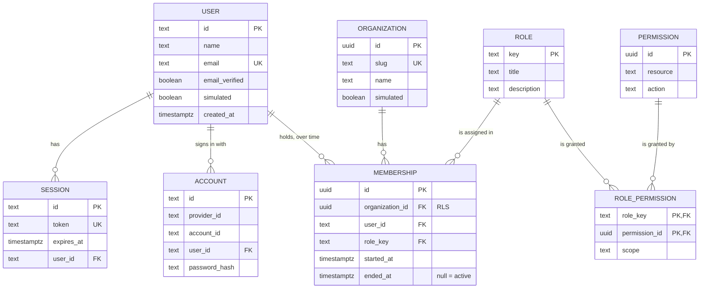

# Expathio — Phase 1 Database Architecture

**Status:** PROPOSED  
**Document type:** Technical proposal (database architecture)  
**Project:** Expathio  
**Proposed by:** Architecture and Quality session  
**Date:** 2026-11-17 (revised the same day after the owner's decisions)  
**Approval needed from:** Project owner, after reviewing the diagram in section 4. Business rules flagged in section 14 also need Product and Documentation.

This document is a proposal. It is not a decision. It becomes a decision only when the owner approves it, and then it is recorded in `docs/decisions/` (`CLAUDE.md`, section 5).

---

## 0. Revision notes (2026-11-17)

The owner reviewed the first version and decided the following. The decisions are relayed by Product and Documentation. They are not yet an approval of the architecture.

| Question | Owner decision | Where it is applied |
|---|---|---|
| Q-026 (direction) | Do not limit the choice by complexity. Recommend Alternative B (database-enforced isolation, PostgreSQL row-level security). | Sections 1, 5.4, 7, 13, 14 |
| Q-031 (test accounts on the phone) | Approved: test accounts stay on the phone, together with the MONUMENT reference data. | Section 9 |
| Q-032 (membership history) | Keep the history of memberships from Phase 1, with start and end dates. | Sections 6, 7.3, 12 |
| Q-034 (runtime editing of permissions) | No editing in the application until Phase 2. The versioned file stays the only way to change permissions. | Section 8.1 |
| Q-027 (one role per account) | One role per account in one organization. Whether one account can be linked to two organizations at the same time is left open (new entry Q-041). | Sections 7.3, 14 |
| Q-028 ("own") | "Own" means assigned to the occupant of the role. | Section 8.2 |
| Q-029 (action vocabulary) | Not changed yet. Product will propose more natural names. The four actions stay in this document until then. | Section 8.2 |
| Q-030 (customer data) | Accepted as a provisional recommendation. The schema is prepared for protected columns. | Section 8.4 |
| Q-033 (glossary terms) | Section 3 is the proposed text. Approval is pending. | Section 3 |

Context from the owner, not designed here: the MONUMENT organization will be founded with one store at the first opening, instead of two. Product will review roles and stores. This may change the stock-by-location design (ADR 0017). Stock tables are not part of Phase 1 and are not changed by this proposal.

---

## 1. Summary

The database is the place where the organization's state is stored, and the rules for who may see and change that state depend on it (`05-TECHNICAL-ARCHITECTURE.md`, sections 5 and 10). Phase 1 must prove three things: a test account can log in, it is a member of an organization with a role, and the data of one organization cannot be seen from another.

We recommend:

1. **One PostgreSQL database, one schema, shared by all organizations.** Every table that describes organizational activity carries an `organization_id`. This is the approved direction of ADR 0010 and `05`, section 10.
2. **Isolation enforced by the database itself (Alternative B).** Row-level security (RLS) in PostgreSQL makes the database refuse to return or change a row of another organization, even when the application forgets a filter. The application connects with a restricted database role, and each transaction states the organization it works for.
3. **Keys and backend rules as well.** Foreign keys that include `organization_id` stop a row from pointing to another organization's parent. The backend takes the organization from the authenticated membership, never from the request body. Tests try to cross organizations and must fail.
4. **Membership history.** A membership is never deleted. Ending a role or leaving an organization sets an end date, and a new membership starts the next role. Each organization has at most one active occupant per role, and each account has at most one active role per organization.
5. **Permissions are data.** The permission matrix in `08-COMPANY.md`, section 6.1, is stored as rows in two tables (`permissions` and `role_permissions`). The rows are loaded from one versioned file in `shared/` by an idempotent seed, so they are reviewed in Git like code. Changes go through the file until Phase 2 (owner decision).
6. **Migrations are SQL files generated by Drizzle Kit, versioned in Git, applied by the deployment script before restart.** Each schema change is one migration file. Tests build the database from the migration files, not from the schema file, so the tests check what production will run.
7. **Integration tests run against PostgreSQL in Docker** (ADR 0016), with the PostgreSQL version pinned to match the phone once Q-007 is answered.

**Cost:** R$ 0 per month for the Phase 1 setup (local Docker and the phone). Maintenance effort is moderate: each organization-owned table needs a policy and a test (section 13).

The draft schema on branch `feat/phase-1-backend-foundation` has the right tables and the right ideas, but it needs the changes in section 12 before it can be the base. This proposal does not change that branch.

---

## 2. Scope and inputs

**In scope:** the Phase 1 entities and their relations, ownership by organization, database-enforced isolation, keys and constraints, membership history, the permission data, the seed with test accounts, the migration process and the database test process.

**Out of scope:** business tables of later phases (products, orders, cases, ledgers, stock by location), the deployment script (Infrastructure and Operations), the hosting decision for Phase 4 (Q-006), the PostgreSQL version on the phone (Q-007, an input only).

**Documents read:** `CLAUDE.md` (sections 2, 5, 7, 8, 10, 11, 12), `docs/CURRENT_STATE.md`, `docs/05-TECHNICAL-ARCHITECTURE.md` (sections 5, 10, 12, 16, 19), `docs/06-ROADMAP.md` (section 4), `docs/08-COMPANY.md` (sections 5 and 6.1), `docs/02-BUSINESS-SIMULATION.md` (section 3), `docs/OPEN-QUESTIONS.md`, `docs/SESSION-STRUCTURE.md` (section 3.2).

**Decisions used:** ADR 0007 (one occupant per role), 0009 and 0027 (four roles and their titles), 0010 (isolation, statelessness, file storage, idempotent jobs), 0013 (NestJS and Drizzle), 0014 (pg-boss, better-auth, Vitest, Playwright), 0016 (three test levels, Docker PostgreSQL, migrations required), 0017 (stock by location, not changed here), 0019 (folder layout: `server/db`, `shared/`), 0022 (test accounts only), 0023 (direct membership), 0024 (four business roles loaded as data), 0028 (e-mail login, simulated-data label).

**Draft used as input:** `server/db/schema.ts` and `server/db/migrations/0000_phase1_foundation.sql` on `feat/phase-1-backend-foundation` (commit `c270179`). Treated as one option, not as the base (section 12).

---

## 3. Terms used in this document (proposed text for the glossary, Q-033)

The word "account" has two meanings in the project's technical libraries. This document uses the following terms:

| Term in this document | Meaning | Table |
|---|---|---|
| **Account** (business sense, as in ADR 0022) | A person's login identity: name, e-mail, verification state | `user` (the name better-auth requires) |
| **Login method** | The credential used to sign in (for example, e-mail and password) | `account` (better-auth's table; it is not the business account) |
| **Organization** | A simulated company. Phase 1 has one: MONUMENT | `organizations` |
| **Membership** | The link between an account, an organization and a role, with start and end dates (ADR 0023) | `memberships` |
| **Active membership** | A membership with no end date | `memberships` where `ended_at` is empty |
| **Role** | A business role, for example Finance Assistant (ADR 0027) | `roles` |
| **Permission** | One action on one resource, for example "read orders" | `permissions` |
| **Role permission** | The grant of a permission to a role, with its scope | `role_permissions` |
| **Test account** | A fictional account created by the owner or the test setup (ADR 0022) | `user` with the simulated flag (section 9) |

The glossary (`docs/GLOSSARY.md`) does not define these table-level terms yet (Q-033).

---

## 4. Demonstration: entities and relations

The diagram shows the eight Phase 1 tables, with the membership history. The gray tables are global (no organization). The blue table is organization-owned and protected by row-level security. The same diagram is saved as an image: `docs/database/phase-1-entities.svg`.

Image version: `docs/database/phase-1-entities.svg`. Open it in a browser to see it outside an editor.

### Relations in words

| From | Relation | To | Meaning |
|---|---|---|---|
| Account | 1 to many | Session | An account can be signed in on several devices. |
| Account | 1 to many | Login method | An account can have one or more ways to sign in. Phase 1 uses e-mail and password. |
| Account | 1 to many | Membership | An account has its memberships over time: one active role per organization, and past memberships kept as history. |
| Organization | 1 to many | Membership | Every membership belongs to exactly one organization. |
| Role | 1 to many | Membership | A role has at most one active occupant per organization (ADR 0007). Past occupants stay in the history. |
| Role | 1 to many | Role permission | A role has several permission grants. |
| Permission | 1 to many | Role permission | A permission can be granted to several roles. |

---

## 5. How organization ownership is stored and enforced

### 5.1 Classification rule

Every table is in one of two groups. The rule is applied when a table is created.

- **Global table:** holds identity data, sessions, or reference data that is the same for every organization. It has no `organization_id` and no row-level security. Phase 1 global tables: `user`, `session`, `account`, `verification`, `roles`, `permissions`, `role_permissions`.
- **Organization-owned table:** holds data that describes what happens inside an organization. It must have `organization_id NOT NULL`, and row-level security enabled with the policies of section 5.4. Phase 1 organization-owned table: `memberships`. `organizations` is the tenant root and is covered in 5.4.

A later table that describes organizational activity (a product, an order, a case) is organization-owned by default. A table that is an exception needs a written reason in the migration's comment.

### 5.2 Composite keys for child tables

From Phase 2 on, a child row must not point to a parent row of another organization. Phase 1 has only one organization-owned table, so this rule has no effect on Phase 1 data, but the pattern must be fixed now:

- Each organization-owned parent table has a unique key on `(organization_id, id)`.
- Each organization-owned child table references the parent with a composite foreign key: `(organization_id, parent_id)` references `parent (organization_id, id)`.

The database then refuses a row whose `organization_id` does not match its parent, whatever the application does.

### 5.3 Enforcement in the application

- The organization of a request comes from the membership of the authenticated account, not from a field the browser sends. Background jobs carry the `organization_id` and the acting account in their payload and set them again when they run (ADR 0010, `05`, section 10).
- If a request names an organization in which the account has no active membership, the answer is "not found", not "forbidden". This does not reveal that the organization exists.
- The database layer refuses to run an organization-scoped query when no organization is set in the transaction. The error is explicit and is tested (`CLAUDE.md`, section 10: no silent failures).
- The Phase 1 access rules (section 8) are checked by the backend on each request, in addition to the database rules. Hiding a menu item is not access control (`CLAUDE.md`, section 10; ADR 0024).

### 5.4 Database-enforced isolation (row-level security)

PostgreSQL's row-level security (RLS) attaches a rule to each table. The rule decides which rows a query can read, insert, update or delete, based on settings of the current transaction. Phase 1 uses it as follows.

**Database roles (two):**

| Role | Used by | Rights |
|---|---|---|
| `expathio_owner` | Migrations and the seed, run by the deployment script or the owner | Owns the tables. Creates and changes them. |
| `expathio_app` | The running application, the workers and the tests | Reads and writes data. Not the owner, no `BYPASSRLS`, not a superuser. |

The application never connects as the owner. The tables use `FORCE ROW LEVEL SECURITY`, so the owner is subject to the rules too. The seed sets the organization for each organization-scoped write it makes. Creating these two roles is part of the server setup, done once on each machine by the owner or by the Infrastructure session; the exact steps are not decided here.

**Settings for each transaction:**

- `app.organization_id`: the organization the transaction works for. Set with `set_config('app.organization_id', <id>, true)`. The third argument makes it last only for the current transaction, so a pooled connection cannot keep a previous organization.
- `app.user_id`: the account making the request, set the same way after the session is checked.
- `app.role_key`: the role of the account in that organization, set for transactions that need the role (permission checks in later phases).

**Policies on `memberships`:**

- Read: a row is visible when its `organization_id` equals `app.organization_id`, or when its `user_id` equals `app.user_id`. The second condition lets a signed-in account see its own memberships in every organization before one is chosen.
- Insert, update, delete: allowed only when `organization_id` equals `app.organization_id` (the write check). Rows are never deleted by the application (7.4); the policy for delete is written anyway and tested.

**Fail closed:** when a setting is missing, `current_setting(..., true)` returns no value and the rule matches no row. A query without context returns nothing, and cannot write.

**`organizations`:** a row is visible to an account only when the account has an active membership in it (a policy that checks `memberships`). No application writes organizations in Phase 1, and the seed is the only writer.

**Global tables:** `user`, `session`, `account`, `verification`, `roles`, `permissions` and `role_permissions` have no row-level security. Login must read `user` before any organization is known, and the catalog is the same for everyone.

**Background jobs (pg-boss):** pg-boss keeps its own tables in its own schema, which are global. Each job handler opens a transaction, sets `app.organization_id` and `app.user_id` from the job payload, and does its work in that transaction. A job without these values is refused.

**What is not protected by RLS:** the catalog and the seed (global, reviewed by the file), and the rule that a membership is ended and not deleted (checked by the application and by tests). RLS protects the rows, not the business rules.

---

## 6. Phase 1 tables: purpose, owner and key

| Table | Group | Purpose | Primary key | Main unique constraints |
|---|---|---|---|---|
| `user` | Global | The account (person's login identity). | `id` (text, from better-auth) | `email` (case-insensitive, see 7.1) |
| `session` | Global | A signed-in session. | `id` (text) | `token` |
| `account` | Global | A login method, with the password hash. | `id` (text) | none beyond the key |
| `verification` | Global | Short-lived tokens (for example, e-mail confirmation). Not used in Phase 1 flows, kept because better-auth needs it. | `id` (text) | none |
| `organizations` | Tenant root | The organization. Phase 1 has MONUMENT. | `id` (uuid) | `slug` |
| `roles` | Global catalog | The four business roles (ADR 0027). | `key` (text, stable, for example `finance-assistant`) | none beyond the key |
| `permissions` | Global catalog | Each resource and action that the system can check. | `id` (uuid) | `(resource, action)` |
| `role_permissions` | Global catalog | Which role has which permission, with its scope. | `(role_key, permission_id)` | the key itself |
| `memberships` | Organization-owned, history kept | The account's role in one organization, over time. | `id` (uuid) | partial unique indexes on active rows (7.3) |

Notes:

- better-auth requires the names and the text key type of `user`, `session`, `account` and `verification`. These four are kept as the draft has them. Our own tables use `uuid`, see section 7.2.
- `roles.key` is a stable text key, not a generated number, because the role is referred to by name in code and in the permission file.

---

## 7. Keys and constraints

### 7.1 Rules for all tables

- Every timestamp is `timestamptz` (timestamp with time zone). The draft uses `timestamp` without a zone. The simulation shows times in Brazil and may be used from other time zones; storing the zone removes that ambiguity.
- Every table has `created_at`. Tables whose rows change have `updated_at`.
- E-mail is unique without regard to upper and lower case. The index is on `lower(email)`. Without this, `Ana@x.test` and `ana@x.test` can be two accounts.
- Foreign keys are declared in the database, not only in code.
- Each enumerated value (scope, action) has a `CHECK` constraint with its allowed values, so an invalid value is refused by the database.
- Every organization-owned table has an index that starts with `organization_id`, because the policies filter on it.

### 7.2 Keys

- Our own tables use `uuid` primary keys generated by the application (`crypto.randomUUID()`). This does not depend on the PostgreSQL version, which is still open (Q-007). The `gen_random_uuid()` function is available without extra extensions only from PostgreSQL 13 on.
- Stable reference keys are text: `roles.key`, and `organizations.slug` (for example `monument`) as a unique text value in addition to the `uuid`.
- better-auth tables keep their own text keys, as required by the library.

### 7.3 Constraints per table

**`organizations`**
- `id uuid` primary key.
- `slug text` unique, lowercase, `CHECK (slug ~ '^[a-z0-9-]+$')`.
- `name text` not null.
- `simulated boolean` not null, default `true`. The interface label for simulated data (ADR 0028) reads this value.
- `created_at`, `updated_at` `timestamptz` not null.

**`roles`**
- `key text` primary key.
- `title text` not null, `description text` not null.

**`permissions`**
- `id uuid` primary key.
- `resource text` not null, `action text` not null, `CHECK (action IN ('read', 'change', 'request', 'decide'))`.
- Unique `(resource, action)`.

**`role_permissions`**
- Primary key `(role_key, permission_id)`.
- `role_key` references `roles.key`. `permission_id` references `permissions.id`.
- `scope text` not null, `CHECK (scope IN ('organization', 'own', 'case'))`. The meanings are in section 8.2.

**`memberships`** (history kept, owner decision Q-032)
- `id uuid` primary key.
- `organization_id uuid` not null, references `organizations.id`.
- `user_id text` not null, references `user.id`, `ON DELETE RESTRICT` (see 7.4).
- `role_key text` not null, references `roles.key`.
- `started_at timestamptz` not null, default `now()`.
- `ended_at timestamptz` nullable. Empty means the membership is active.
- `CHECK (ended_at IS NULL OR ended_at > started_at)`.
- Partial unique index on `(organization_id, user_id) WHERE ended_at IS NULL`: one active role per account per organization (owner decision Q-027).
- Partial unique index on `(organization_id, role_key) WHERE ended_at IS NULL`: one active occupant per role per organization (ADR 0007). Past occupants remain in the table.
- Index on `(user_id)` for the lookup of a signed-in account's memberships.
- `created_at`, `updated_at` `timestamptz` not null.
- Row-level security with the policies of 5.4.

A role change or departure is one transaction: the active row gets `ended_at`, and a new row is inserted when there is a new role. Whether one account may be active in two organizations at once is not decided by these indexes (they are per organization). It is an open point (Q-041).

**`user`**
- `id text` primary key (better-auth), `email` unique on `lower(email)`, `simulated boolean` not null default `true` (proposed, section 9).

### 7.4 Deletion rules

- Memberships are history. The application never deletes them. `memberships.user_id` uses `ON DELETE RESTRICT`, so a user row with history cannot be removed by accident. The draft uses `CASCADE`. Account removal for personal-data rights needs its own rule before Phase 4 (Q-002).
- `session` rows cascade with the account: a removed account must not keep a sign-in.

---

## 8. Permissions as data

### 8.1 Source of the permissions

`docs/08-COMPANY.md`, section 6.1, is the approved source (owner, 2026-11-06). The permission rows are written in one versioned file, `shared/access-rules.ts` (ADR 0024 names this file). The seed (section 9) copies that file into the `permissions` and `role_permissions` tables with upserts. The backend checks permission rows from the database when it authorizes a request. The rows and the file must agree; an integration test checks that they do (section 11).

Changes to permissions go through the file and a deployment. There is no editing in the application until Phase 2 (owner decision, Q-034). The file keeps every change reviewed in Git.

### 8.2 Vocabulary

| Field | Values | Meaning |
|---|---|---|
| `action` | `read` | See the record; no change |
| | `change` | Create or modify records of this kind |
| | `request` | Send a request that another role decides |
| | `decide` | Approve or reject a request sent by another role |
| `scope` | `organization` | All records of the organization of this kind |
| | `own` | Records assigned to the occupant of the role (owner decision Q-028) |
| | `case` | Records linked to a case the role works on (for example, the orders of a customer in an open case) |

The action names are not final. The owner asked for more natural names, and Product will propose them (Q-029). Until then the four names above are used, and changing them later means changing the file and the `CHECK` constraint in one migration.

The four actions are the minimum that `08-COMPANY.md`, section 6.1, needs. The draft's `access` text and `own_records_only` boolean cannot represent "request" and "decide" separately, or the case scope. That is why the draft is not used as the permission model (section 12).

### 8.3 Seed rows from `08-COMPANY.md`, section 6.1

Each row is one `role_permissions` entry. Resource names are proposals, in English, as the product uses English (`CLAUDE.md`, section 9).

| Resource | Operations Assistant | Customer Service Representative | Sales Support Assistant | Finance Assistant |
|---|---|---|---|---|
| `stock_levels` | change, organization | — | — | — |
| `orders` | read, organization | read, case | read, organization | read, organization |
| `fulfillment_queue` (queue and deliveries) | change, organization | — | — | — |
| `customer_cases` | — | change, own | — | — |
| `customer_contact_history` | — | read, organization | — | — |
| `refund_exchange_requests` | — | request, organization | — | read and decide, organization |
| `payment_refund_ledger` | — | — | — | change, organization |
| `revenue_report` | — | — | — | change, organization |
| `sales_dashboard` | read, organization | read, organization | read, organization | read, organization |
| `task_board` (own tasks) | change, own | change, own | change, own | change, own |
| `internal_messages` | read and send, own role | read and send, own role | read and send, own role | read and send, own role |
| `organization_documents` | read, organization | read, organization | read, organization | read, organization |
| `session_summary` | read, own role | read, own role | read, own role | read, own role |

Notes on the table:

- For Finance, "decide" on refund requests is stored with "read" as a separate row, because a role that decides must also read. The matrix in `08` lists both in one cell. The backend checks the stronger action.
- `internal_messages` and `session_summary` use the "own role" meaning of the scope: messages and summaries of the role's own work area. This is not the "own" of section 8.2. Product should confirm this (Q-028 covers "own"; the messages case is part of Q-029).
- `stock_levels` change is "replenishment requests" in `08`. In Phase 1 no behavior is attached, so this row is only data. The stock design by location (ADR 0017) is under review by Product and is not designed here.

### 8.4 Customer data visibility (provisional, owner accepted as recommendation, Q-030)

The owner accepted this provisional rule. It is a business rule, so Product confirms it in its documents.

| Role | Customer contact (name, e-mail, phone) | Order and delivery address | Amounts and payments |
|---|---|---|---|
| Operations Assistant | no | yes (for the delivery) | no |
| Customer Service Representative | yes (in the service) | yes (in the case) | yes (in the case) |
| Sales Support Assistant | no | no (orders without address) | no |
| Finance Assistant | no | no | yes |

Schema preparation for this rule, to be used when the customer tables exist in Phase 2 (no table is created in Phase 1):

- Customer contact fields are stored in their own table (for example `customer_contacts`), separate from the customer's order data. A permission resource (`customer_contact`) controls who reads it.
- Its row-level security policy uses `app.role_key` and `role_permissions`, so the database refuses the contact rows to a role that has no grant for `customer_contact`.
- Other protected fields follow the same pattern: a separate table with its own resource. This keeps the rule in data and avoids column-level policies, which are harder to test.
- Phase 1 seeds no customer data. The `customer_contact_history` row above is kept for the future case queue.

---

## 9. Seed with test accounts

ADR 0022 allows test accounts only in Phase 1. The owner decided that test accounts stay on the phone, together with the reference data (Q-031). The seed creates:

- The organization MONUMENT, with `slug = 'monument'`, `simulated = true`. One store or two is a Product decision in progress and does not affect the seed.
- The four roles (ADR 0027 titles) and the permission rows of section 8.3.
- Four test accounts, one per role, each with one active membership. Names are fictional. E-mails use the reserved domain `expathio.test` (the `.test` top-level domain is reserved for tests and is not a real address).
- One test account with no membership, to test that a signed-in account without a role sees nothing of the organization.

Rules for the seed:

- It is idempotent: running it twice gives the same result (ADR 0010, idempotent operations). Test accounts are created only when missing.
- It runs as `expathio_owner` and sets the organization context for each organization-scoped write.
- Passwords are never written in the repository or on the phone's disk in plain text (`CLAUDE.md`, section 11). The owner enters them when the seed runs, from the console or an environment variable that is not stored in the repository. The hashes are stored by better-auth.
- The seed is in `server/db/seed/`. Reference data (organization, roles, permissions) is loaded on every deployment. Test accounts are loaded by the owner when the phone is set up and by the test setup on the development computer.
- The interface marks every test account as simulated (ADR 0022, ADR 0028), from the `simulated` flags.

---

## 10. Migrations and versioning

### 10.1 How migrations are written

- The schema is written in TypeScript in `server/db/schema.ts` (ADR 0013).
- Drizzle Kit generates the SQL migration file from the schema. The SQL files are kept in `server/db/migrations/`, numbered in order, with Drizzle's journal file.
- Row-level security (enable, force, policies) and the database roles' grants are written as SQL in migration files. The exact way (schema declaration or custom SQL migration) is chosen when the Platform Engineering session builds it; either way the migration file is the record.
- One migration per change. A migration that mixes unrelated changes is split before it is committed.
- Migration files are never edited after they have been applied to any database, including a test database that someone else may use. A correction is a new migration.
- Each schema change is committed with its migration file (ADR 0016). A schema change without its migration is refused by the test run (section 11).

### 10.2 How migrations are applied

- The deployment script applies migrations before it restarts the application (ADR 0016). If a migration fails, the script stops, and the old version keeps running.
- Migrations run in the same order in development, in tests and on the phone.
- Reference data (section 9) is not a migration. It is applied by the seed after the migrations, so it can be updated when `shared/access-rules.ts` changes without a new migration.

### 10.3 Rollback

Drizzle Kit does not generate reverse ("down") migrations. The rollback described in ADR 0016 is therefore one of two things:

1. Restore the daily backup (ADR 0011), which is the reliable path.
2. Write a reverse migration by hand, for a change that is small and tested.

This is recorded as an input to Q-009 (Infrastructure and Operations). The rollback steps are not decided here.

### 10.4 Version record

The migration journal is the version record of the schema. The schema version is the last migration file in the journal. Release history (ADR 0020) records the application version that ran it.

---

## 11. Testing against PostgreSQL in Docker

This follows ADR 0016 (three test levels) and ADR 0015 (Docker on the Windows computer).

### 11.1 Environment

- A Docker Compose file starts one PostgreSQL container. It belongs to `ops/` (owned by Infrastructure and Operations), as it is the environment and not the application.
- The PostgreSQL image is pinned to a specific version. The version must match the phone's version, which is an open input (Q-007). Until Q-007 is answered, the proposal does not fix a version number. Row-level security needs PostgreSQL 9.5 or later.
- The container data is temporary. A test run creates a new empty database, applies all migrations as `expathio_owner`, creates the `expathio_app` role, runs the seed and removes the database at the end.

### 11.2 Tests

Tests that touch the database connect as `expathio_app`, the same role the application uses, unless the test is about the owner.

| Test | What it checks | Level (ADR 0016) |
|---|---|---|
| Migrations apply to an empty database | Every migration file runs in order without error | Integration |
| Schema matches migrations | Drizzle Kit reports no pending change between `schema.ts` and the migrations | Integration |
| Seed is idempotent | Running the seed twice produces the same rows | Integration |
| Permission rows match the file | The database rows equal `shared/access-rules.ts` | Business rule with database |
| Application role has no extra rights | `expathio_app` is not the owner, has no `BYPASSRLS` and is not a superuser | Integration |
| No context, no rows | A query on `memberships` without `app.organization_id` or `app.user_id` returns nothing | Integration (RLS) |
| Other organization is invisible | With organization A set, rows of organization B are not returned | Integration (RLS, ADR 0010) |
| Cross-organization write is refused | An insert or update with organization B while A is set fails | Integration (RLS) |
| Owner is subject to the rules | The owner role, with the table forced, also sees no rows without context | Integration (RLS) |
| Context does not leak between transactions | After a transaction sets A, the next transaction on the same pooled connection without a setting sees nothing | Integration (RLS) |
| History is kept | Ending a membership sets `ended_at`; the row remains; a role change creates a new row | Integration |
| One active role per account and per role | A second active membership for the same account or role in the same organization fails; a past one does not | Integration (ADR 0007, Q-027) |
| Ended membership cannot be deleted by the application | The delete path is absent from the repository, and a delete under the app role is refused by the policy | Integration |
| Duplicate e-mail in different case is refused | `Ana@x` and `ana@x` cannot both exist | Integration |
| Organization with no membership is invisible | An account without an active membership gets "not found" for the organization | Integration, then flow test |
| Composite foreign key refuses a foreign child | A child row with another organization's parent is refused by the database (from Phase 2, when child tables exist) | Integration |
| Full sign-in flow | Sign in as the Finance test account, see its organization and role, label "simulated" | Flow (Playwright, ADR 0016) |

Test data is created by the tests (ADR 0016). No participant data is used (`CLAUDE.md`, section 11).

### 11.3 What the owner runs

The owner runs the test suite on the Windows computer before each merge (ADR 0016). The exact commands are written when the Platform Engineering session builds the test setup.

---

## 12. Review of the draft on `feat/phase-1-backend-foundation`

The draft was written before any database architecture was approved. It is read here as one option.

**Keep**

- The two groups of tables (identity and organization) and the comment that explains them.
- `memberships` with `organization_id NOT NULL`, and the one-occupant rule (ADR 0007), now as partial unique indexes.
- better-auth table names and columns.
- `organizations.simulated` for the interface label.
- `roles.key` as a text primary key.

**Change**

| Draft | Problem | Proposed |
|---|---|---|
| `role_permissions.access` (free text) and `own_records_only` (boolean) | Cannot express "request" and "decide" separately, nor the case scope. Free text allows any value. | `permissions` (resource, action) and `role_permissions` (role, permission, scope), with `CHECK` constraints (section 8) |
| `role_permissions.resource` free text | Any typo creates a new resource silently | Resource list in the `permissions` table, seeded from the file |
| `memberships` unique on `(organization_id, user_id)` and `(organization_id, role_key)` for all rows | Blocks history: a second role for the same account, or a new occupant after a departure, cannot be recorded | Partial unique indexes on active rows only, plus `started_at` and `ended_at` (section 7.3, owner decision Q-032) |
| No row-level security | Isolation depends on the application | Two database roles and policies (section 5.4) |
| `timestamp` without zone | Ambiguous times | `timestamptz` |
| `user.email` unique as written | `Ana@x` and `ana@x` are two accounts | Unique index on `lower(email)` |
| `memberships.user_id` `ON DELETE CASCADE` | A membership is history and could disappear silently | `ON DELETE RESTRICT` (section 7.4) |
| `memberships` without `updated_at` | Role changes need a time | Add `updated_at` now (the column is cheap) |
| `organizations` without `slug` | The seed and tests need a stable name for MONUMENT | Add `slug` (unique) |
| `user` without a simulated flag | Test accounts cannot be marked in the interface (ADR 0022) | Add `simulated` (section 9) |
| `organizations.id` and `memberships.id` as text | Works, but weaker than a UUID | `uuid` generated by the application (section 7.2) |

**Keep for later:** the composite foreign key pattern (section 5.2), which the draft does not use yet because it has no child tables.

The draft's migration `0000_phase1_foundation.sql` must be regenerated after these changes. This proposal does not change the branch.

---

## 13. Alternatives

Three alternatives are compared. The owner asked for the recommendation to be Alternative B.

### Alternative B (recommended): shared schema, organization column, database-enforced isolation (row-level security), plus keys, backend rules and tests

Described in sections 5 to 11.

| | |
|---|---|
| **Advantages** | A forgotten filter in the application is blocked by the database. Isolation does not depend on each developer remembering the filter. Matches the owner's priority on safety over simplicity. Still one database, one schema and one migration path. Costs nothing extra. |
| **Disadvantages** | Every organization-owned table needs policies and tests. Every connection and job must set the transaction context, which is easy to get wrong with a connection pool and pg-boss; the tests cover the common mistakes (context leak, missing context). The owner role must be kept apart from the application role. Errors look like empty results, so the explicit check in 5.3 is needed. Debugging a query needs the context set. |
| **Impact** | Medium. The connection and transaction layer changes, and two database roles are created once per machine. Each new organization-owned table adds policies, an index and tests. |
| **Cost, monthly** | R$ 0 (a feature of PostgreSQL that is free). Phase 4 hosting cost is not estimated here; it depends on Q-006. |
| **Maintenance effort** | Moderate. The main effort is the first setup of the policies and tests, then one policy and one test per new organization-owned table. Changes to the policies are migrations like any other. |

### Alternative A: shared schema, organization column, enforced by keys, backend and tests (no row-level security)

The same schema and history as B, but the isolation rule lives only in the backend and in the tests.

| | |
|---|---|
| **Advantages** | Simplest to build and read. One database role. No transaction context to set. Works on any PostgreSQL version. |
| **Disadvantages** | A new query written outside the repository layer can miss the filter until a test catches it. The database cannot refuse a cross-organization read, so a bug shows up as wrong data, not as an error. |
| **Impact** | Small. Fewer moving parts in the connection layer. |
| **Cost, monthly** | R$ 0. |
| **Maintenance effort** | Low now; higher later, because every new query must be reviewed for the filter. |

### Alternative C: one PostgreSQL schema (or database) per organization

Each organization gets its own schema, and migrations are applied to each one.

| | |
|---|---|
| **Advantages** | Strongest structural separation. A query cannot reach another organization by mistake, because it does not see its tables. Deleting an organization is a drop. |
| **Disadvantages** | Migrations and seeds run once per organization. Backups, the job queue and the tests multiply. Cross-organization features (for example, a shared catalog or the future multi-organization platform, Phase 8) become harder. ADR 0010 and `05`, section 10, describe a shared database with organization-scoped records as the expected starting point. |
| **Impact** | High. Changes migrations, the connection layer, the seed and the backup procedure. |
| **Cost, monthly** | R$ 0 on the phone for a few organizations. Cost rises with the number of organizations, which is not known. |
| **Maintenance effort** | High. Every schema change runs once per organization. |

### Comparison

| | B (recommended) | A (no RLS) | C (schema per organization) |
|---|---|---|---|
| Isolation enforced by | Database policies, keys, backend, tests | Keys, backend, tests | Separate schemas |
| Forgotten filter in code | Blocked by the database | Caught only by tests | Structural |
| Works on any PostgreSQL version | Needs PostgreSQL 9.5 or later | Yes | Yes |
| Phase 1 effort | Medium | Low | Highest |
| Monthly cost (Phase 1) | R$ 0 | R$ 0 | R$ 0 for few organizations |
| Maintenance | Moderate | Low now, higher later | High |

---

## 14. Recommendation and open points

**Recommendation:** Alternative B. Shared schema with `organization_id`, database-enforced isolation with row-level security from Phase 1, keys and backend rules on top, membership history, permissions as seeded data, and test accounts on the phone with the reference data. The owner approves it after reviewing the diagram (Q-026).

Open points are registered in `docs/OPEN-QUESTIONS.md`, with their destination function. Summary:

| Question | Destination | Entry |
|---|---|---|
| Approve Alternative B as the Phase 1 direction, after the diagram | Owner | Q-026 |
| Can one account hold more than one role in the same organization? Answered: no, one at a time. | Product and Documentation (confirm) | Q-027 |
| What "own" means for tasks, cases and messages. Answered: assigned to the occupant. | Product and Documentation (confirm) | Q-028 |
| Action names (`read`, `change`, `request`, `decide`) and the messages case | Product and Documentation (proposing names) | Q-029 |
| Which customer data each role may see. Provisional rule in 8.4. | Product and Documentation | Q-030 |
| Test accounts on the phone. Answered: yes. | Owner | Q-031 |
| Membership history from Phase 1. Answered: yes. | Owner | Q-032 |
| Glossary terms (section 3) | Product and Documentation | Q-033 |
| Runtime editing of permissions. Answered: not before Phase 2. | Owner | Q-034 |
| Can one account be active in two organizations at the same time? | Owner | Q-041 |

**Inputs, not decided here:**

- **Q-007** (PostgreSQL and Node.js versions on the phone). The Docker image version and the UUID approach depend on it. Owned by Infrastructure and Operations; answered by them.
- **Q-006** (hosting for Phase 4). Decides the monthly cost of the Phase 4 database.
- **Q-009** (rollback steps). Section 10.3 gives the Drizzle constraint.
- **Q-002** (participant privacy). The account removal rule in section 7.4 depends on it.
- **Q-012** (adding a role without a code change). Section 8 makes new roles data, but only for existing resources. A new resource is still a code change.
- **ADR 0017** (stock by location). Product is reviewing the store count and roles; the stock design is not part of this proposal.
- **Creation of the two database roles** on each machine (section 5.4): who runs it, and when. Proposed for Infrastructure and Operations with the Platform Engineering session.

---

## 15. Deliberately left out of Phase 1

- **Business tables** of later phases: products, stock, orders, cases, ledgers, reports (Phases 2 and 3).
- **Customer tables**, including the customer contact table of section 8.4 (Phase 2).
- **Audit and event tables** (`05`, section 12; first needed in Phase 3).
- **Vacancy and application tables** (ADR 0005, ADR 0023, ADR 0026: Phase 2 or later).
- **Editing of permissions in the application** (owner decision Q-034).
- **Partitioning, read replicas, connection pooling beyond the library default** (ADR 0010, `05`, section 18: not needed for one organization on one phone).
- **pg-boss job tables.** The library creates and manages them in its own schema. Background jobs must carry the context of section 5.4.
- **File metadata tables.** File storage is behind an abstraction (ADR 0010); no table is designed for it in Phase 1.
- **Login features beyond the basic flow:** password recovery (ADR 0028), social login, multi-factor login.
- **Organization creation** (`01-PRODUCT.md`, section 10). Phase 1 has the fixed organization MONUMENT only.
- **Participant profile and personal data rules** (Q-002, Phase 4).
- **AI memory and agent tables** (Phase 6).

---

## 16. Next steps after approval

1. The owner reviews the diagram and decides Q-026 (Alternative B). The owner also confirms Q-041, which can be decided later.
2. The approved decision is recorded in `docs/decisions/` by this session (new ADR, sequential number).
3. The Platform Engineering session rebuilds the draft from section 12, regenerates its migration, and adds the database and isolation tests of section 11. Its branch is not changed by this session.
4. Infrastructure and Operations answers Q-007 before the Docker image is pinned, and defines how the two database roles are created on the phone and on the development computer.
