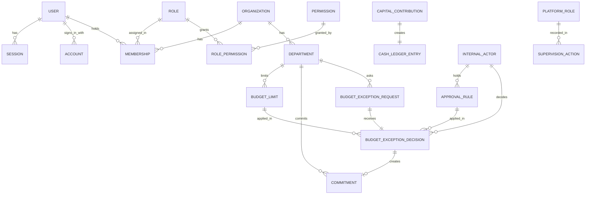

# Expathio — Phase 1 Database Design: Final Review for the Owner

**Status:** FOR OWNER REVIEW  
**Document type:** Review of the approved state of the Phase 1 database design  
**Project:** Expathio  
**Prepared by:** Architecture and Quality session  
**Date:** 2026-11-17  
**Branch:** `docs/arch-database-proposal` (not merged into `main`)

This document gathers the state of the Phase 1 database design in one place. It does not change any decision. It states what is approved, which tables exist and what they are for, what the diagrams show, what is still missing before implementation, and which questions still need the owner or Product.

---

## 1. Summary

- **Architecture approved.** ADR 0032 (Alternative B: database-enforced isolation with row-level security) is approved, with its two amendments: Amendment 1 (financial tables) and Amendment 2 (budget exception flow).
- **Membership rules approved.** ADR 0033: one active membership per account at a time, in one organization; one active occupant per role per organization; membership history kept from Phase 1.
- **Financial scope approved.** ADR 0036 (Product, owner-approved): capital, one cash balance, monthly department limits, commitments, and the budget exception flow in Phase 1, without purchases.
- **Six questions closed by the owner** on 2026-11-17: Q-042, Q-043, Q-049, Q-050, Q-051 and Q-052.
- **Nothing blocks the architecture decision.** Implementation is blocked by two inputs: the PostgreSQL version on the phone (Q-007) and the creation of the two database roles.
- **Three findings need action** (section 7): ADR 0036 still calls Amendment 2 "proposed", the register shows two entries as APPROVED without an explicit owner closure, and five answered questions are still PROPOSED in the register.

---

## 2. Final state of each approved decision

| Item | Status | Date | Approved by | Notes |
|---|---|---|---|---|
| ADR 0032, Phase 1 database architecture (Alternative B) | APPROVED | 2026-11-17 | Project owner (Q-026) | Decisions 1 to 10 unchanged by the amendments. |
| ADR 0032, Amendment 1 (financial tables) | APPROVED | 2026-11-17 | Project owner, relayed by Product and Documentation | Scope: contributions, cash entries, budget limits, commitments, departments that attach limits. |
| ADR 0032, Amendment 2 (budget exception flow) | APPROVED | 2026-11-17 | Project owner, relayed by Product and Documentation | Scope: internal actors, approval rules, requests, decisions, platform roles, supervision actions. Includes the monthly, cash-limit and commitment-expiry rules. |
| ADR 0033, membership history and one active organization | APPROVED | 2026-11-17 | Project owner (Q-027, Q-032, Q-041) | Business text: `docs/08-COMPANY.md`, section 10.6, commit `56c5e56` on branch `docs/company-revision-proposal`, not merged. |
| ADR 0036, Phase 1 financial structure (Product) | APPROVED | 2026-11-17 | Project owner | Owned by Product. Its consequences name both amendments, but still describe Amendment 2 as "proposed". See section 7. |

### Register entries

| Entry | Status in the register | Meaning |
|---|---|---|
| Q-042 (budget period) | APPROVED, closed by the owner | Monthly; no carry-over. |
| Q-043 (department available) | APPROVED, closed by the owner | Limit minus realized spending minus committed. |
| Q-049 (commitment on approval) | APPROVED, closed by the owner | An approved exception creates an open commitment. |
| Q-050 (administrator role) | APPROVED, closed by the owner | Only the owner grants or revokes. |
| Q-051 (company cash cap) | APPROVED, closed by the owner | Company available cash is a mandatory limit. |
| Q-052 (commitment expiry) | APPROVED, closed by the owner | Expiry at the end of the budget month by default. |
| Q-026 (approve the architecture) | APPROVED | Set by this session from the owner's answer. No explicit closure is recorded. |
| Q-041 (one organization at a time) | APPROVED | Set by this session from the owner's answer. No explicit closure is recorded. |

### Answered in the register, still PROPOSED

These have an owner answer recorded but are not closed: Q-044 (departments in Phase 1), Q-045 (exception flow in Phase 1), Q-046 (who approves exceptions), Q-047 (owner and administrator supervision), Q-048 (simulated manager outside participant roles), Q-031 (test accounts on the phone), Q-032 (membership history), Q-034 (permissions only through the file until Phase 2). Q-027 and Q-028 are answered by the owner and await Product's confirmation in its documents.

---

## 3. Tables of Phase 1

Phase 1 has twenty tables in this design, plus the tables that the job library creates in its own schema. Each table belongs either to the global scope (no organization) or to one organization (`organization_id NOT NULL`, with row-level security).

### 3.1 Global tables (no organization)

| Table | Purpose | Source |
|---|---|---|
| `user` | The account: a person's login identity (name, e-mail, verification). | ADR 0022, ADR 0028 |
| `session` | A signed-in session. | better-auth |
| `account` | The login method and the password hash. Not the business account. | better-auth |
| `verification` | Short-lived tokens. | better-auth |
| `roles` | The four participant roles of Phase 1. | ADR 0024, ADR 0027 |
| `permissions` | The catalog of resource and action pairs the system checks. | ADR 0032, decision 6 |
| `role_permissions` | Which role has which permission, with its scope. Loaded from `shared/access-rules.ts`. | ADR 0032, decision 6 |
| `platform_roles` | The owner and the administrator, with the grant record. | Amendment 2; ADR 0036; Q-050 |
| `supervision_actions` | An identified record of each action by the owner or administrator. | Amendment 2; Q-047 |

The job library (pg-boss) keeps its own tables in its own schema. They are not designed here (ADR 0014).

### 3.2 Organization-owned tables (`organization_id NOT NULL`, row-level security)

| Table | Organization it belongs to | Purpose | Append-only |
|---|---|---|---|
| `organizations` | Is the organization itself (tenant root, MONUMENT) | The organization, its slug and whether its data is simulated. Visible only to accounts with an active membership. | No |
| `memberships` | Its organization | The account's role in that organization, with start and end dates. Rows are ended, not deleted. | Ended, never deleted |
| `departments` | Its organization | The eight departments, with minimal scope: only to attach budget limits (Q-044). | No |
| `capital_contributions` | Its organization | Each contribution of capital, with the bank account label and an idempotency key. | Yes |
| `cash_ledger_entries` | Its organization | The one cash balance of the company, as signed entries. | Yes |
| `budget_limits` | Its organization | The monthly limit of a department (Q-042). | Yes |
| `commitments` | Its organization | Amounts promised to a department: open, converted or released, with creation and expiry dates (Q-049, Q-052). | Status changes only |
| `internal_actors` | Its organization | The simulated manager, an internal actor that is not a participant role and not an AI agent (Q-048). | No |
| `approval_rules` | Its organization | The business authority of an internal actor, by action and maximum amount. | New version is a new row |
| `budget_exception_requests` | Its organization | A request for a budget exception, with justification. | Yes |
| `budget_exception_decisions` | Its organization | One decision per request, with outcome, rule used, actor, limit, snapshots and impact. | Yes |

### 3.3 Count by scope

- Global: 9 tables in this design (`user`, `session`, `account`, `verification`, `roles`, `permissions`, `role_permissions`, `platform_roles`, `supervision_actions`).
- Organization-owned: 11 tables, of which `organizations` is the root.

---

## 4. Diagrams

The owner can see the design in four places. Each one is a file in this branch.

| Diagram | File | What it shows |
|---|---|---|
| Core entities (identity, organization, membership, roles, permissions) | `docs/database/phase-1-entities.svg` | Accounts, sessions, login methods, organization, memberships with history, roles and permissions. |
| Financial entities (Amendment 1) | `docs/database/phase-1-financial-entities.svg` | Capital contributions, cash ledger, departments, budget limits, commitments. |
| Budget exception flow (Amendment 2) | `docs/database/phase-1-exception-entities.svg` | Internal actor, approval rules, requests, decisions, budget limits, platform roles and supervision. |
| Whole design, relations only | Section 4.1 below | All Phase 1 relations in one view. |

### 4.1 All relations in one view

### 4.2 Relations in words

| From | To | Meaning |
|---|---|---|
| Account | Session | An account can be signed in on several devices. |
| Account | Membership | Over time; one active membership at a time, in one organization (ADR 0033). |
| Organization | Membership | Every membership belongs to one organization. |
| Role | Membership | At most one active occupant per role per organization (ADR 0007). |
| Role | Role permission | Each role has its permission grants. |
| Organization | Department | Each organization has its departments. |
| Department | Budget limit | One limit per department per month. |
| Department | Commitment | Committed amounts of the department. |
| Capital contribution | Cash ledger entry | One contribution creates one ledger entry. |
| Internal actor | Approval rule | The actor's authority, by rule. |
| Department | Budget exception request | A department asks for an exception. |
| Request | Decision | One decision per request. |
| Decision | Commitment | An approved decision creates an open commitment (Q-049). |

---

## 5. What is missing before implementation

### 5.1 Blocked by Q-007 (Infrastructure and Operations)

- **PostgreSQL version on the phone.** It fixes the Docker image tag, which must match the phone (ADR 0015). The design needs PostgreSQL 9.5 or later for row-level security. The queries are SQL functions, not views, so the design does not need a later version for `security_invoker`.
- **Node.js version on the phone.** It must match the versions of NestJS and Drizzle (ADR 0013, ADR 0014).
- **Until Q-007 is answered**, the test environment cannot be pinned, and no migration can be run on the phone.

### 5.2 Blocked by the database roles (Infrastructure and Operations, with Platform Engineering)

- **Creation of `expathio_owner` and `expathio_app`** on the Windows computer (Docker) and on the phone. The application role must not own tables and must not have `BYPASSRLS`.
- **Grants**: the owner runs migrations and the seed; the application role runs the application, the workers and the tests.
- **Deployment script**: applies migrations as the owner and starts the application as the application role (ADR 0016).
- **Until the roles exist**, no row-level security test can run, and no seed can be loaded.

### 5.3 Not blocking the architecture, but needed before the related tables are seeded

- **Q-029** (action names): the permission rows of the seed use `read`, `change`, `request` and `decide`. Product will propose other names. The seed changes if the names change.
- **Q-033** (glossary terms): the proposed text is in section 3 of the proposal.
- **ADR 0033 business text**: the citation is to commit `56c5e56`, on a branch not yet merged. Product should merge it, or the ADR should cite a merged source.
- **ADR 0034 and 0035** are reserved for the store and role revision. Their outcome may change the stock design (ADR 0017). Stock tables are not part of Phase 1.

### 5.4 Implementation work, after the above

1. Platform Engineering rebuilds the draft schema from ADR 0032, its amendments and ADR 0033. The draft branch `feat/phase-1-backend-foundation` stays on hold until then.
2. Migrations: one migration per change, with the row-level security policies, the role grants and the append-only rules (triggers that refuse update and delete).
3. Permissions file `shared/access-rules.ts` and the seed of reference data (organization, roles, permissions, departments).
4. Test accounts for the phone, and the procedure that sets their passwords without storing them in the repository.
5. Repositories: every organization-scoped query takes the organization from the transaction context.
6. Financial rules: contributions, budget limits, commitments and the exception flow, with the evaluation order of Amendment 2.
7. Supervision: the only logged path for the owner and administrator.
8. Tests as listed in section 11 of the proposal, and in Amendments 1 and 2.
9. Rollback procedure (Q-009).

---

## 6. Questions that still need an answer

### 6.1 For the owner

| ID | Question | Why it matters |
|---|---|---|
| Q-026 | Confirm the closure of the architecture approval. | Status is APPROVED, set from the owner's answer; no explicit closure is recorded. |
| Q-041 | Confirm the closure of the one-organization rule. | Same as above. |
| Q-044 to Q-048 | Close these five entries, which have answers recorded and are still PROPOSED. | The answers are in the register. |
| Q-031, Q-032, Q-034 | Close these three entries, which have answers recorded. | The answers are in the register. |
| Amendments 1 and 2 | Confirm them directly, if you want the approval recorded from you and not relayed. | Both were relayed by Product and Documentation. |
| Q-033 | Approve or change the glossary terms (proposal, section 3), after the demonstration. | The terms are the proposed text. |
| Q-012 | Decide whether a role made only of existing functions may be added as data. | Section 8 makes this possible for existing resources only. |
| Q-006 | Choose the hosting for Phase 4. | Decides the cost of the Phase 4 database. |
| Q-002 | Decide the personal data rules before Phase 4. | Affects the account removal rule (proposal, section 7.4). |

### 6.2 For Product and Documentation

| ID | Question | Why it matters |
|---|---|---|
| Q-027 | Confirm in `08-COMPANY.md` and the roadmap: one role at a time per account in one organization. | ADR 0033 relies on it. |
| Q-028 | Confirm in `08-COMPANY.md` and the roadmap: "own" means assigned to the occupant of the role. | Permission rows depend on it. |
| Q-029 | Propose more natural names for the four actions. | The permission seed depends on them. |
| Q-030 | Confirm in `08-COMPANY.md` the provisional customer data visibility rule. | Needed before the first customer table (Phase 2). |
| ADR 0033 text | Merge `08-COMPANY.md` section 10.6 (commit `56c5e56`), so that the citation is to a merged text. | ADR 0033 cites it. |
| ADR 0036 | Update Amendment 2 from "proposed" to approved, as recorded here. | Stale text in Product's file (section 7). |
| Q-042, Q-043, Q-049 to Q-052 | Product's documents should reflect the closed answers. | Their answers are closed in the register. |

### 6.3 For Infrastructure and Operations

| ID | Question | Why it matters |
|---|---|---|
| Q-007 | PostgreSQL and Node.js versions on the phone. | Blocks the image pin and the phone migration (section 5.1). |
| Creation of the two database roles | Who creates them, on each machine, and how. | Blocks the RLS tests and the seed (section 5.2). |
| Q-009 | Rollback steps of the deployment script. | Drizzle has no reverse migrations (proposal, section 10.3). |

---

## 7. Findings and inconsistencies

1. **ADR 0036 (Product's branch) still says Amendment 2 is "proposed, awaiting owner approval".** The owner approved it on 2026-11-17. This is Product's file, and this session did not change it. Action: Product updates it.
2. **Two register entries show APPROVED without an explicit closure.** Q-026 and Q-041 were set to APPROVED by this session from the owner's answers. The owner has not closed them explicitly, in the way he closed the six entries of section 2. Action: owner confirms or closes.
3. **Five answered entries are still PROPOSED** in the register (Q-044 to Q-048). Action: owner closes them, or confirms the answer.
4. **Amendment 1 and 2 approvals arrived through Product and Documentation.** The approval is recorded in the ADR files with that origin. Action: the owner confirms directly if he wants the record to show his own confirmation.
5. **The financial diagram title still says "PROPOSED design"**. The design is approved as Amendments 1 and 2. This is a label only.
6. **Membership history text.** The proposal's earlier revisions described the membership index differently. The current proposal and ADR 0033 agree: one active membership per account across organizations, one active occupant per role per organization.

---

## 8. Files in this review

- `docs/database/phase-1-database-architecture.md`: the full proposal, with sections 0 to 17.
- `docs/database/phase-1-entities.svg`: core entities.
- `docs/database/phase-1-financial-entities.svg`: financial entities.
- `docs/database/phase-1-exception-entities.svg`: budget exception flow.
- `docs/database/phase-1-final-design-review.md`: this document.
- `docs/decisions/0032-phase-1-database-architecture.md`: ADR 0032 with Amendments 1 and 2.
- `docs/decisions/0033-membership-history-and-one-active-organization.md`: ADR 0033.
- `docs/OPEN-QUESTIONS.md`: the register, with the entries listed above.
- `docs/sessions/architecture-and-quality/2026-11-17-phase-1-database-architecture.md`: the session record.
- `docs/CURRENT_STATE.md` and `docs/05-TECHNICAL-ARCHITECTURE.md`: short status lines.
