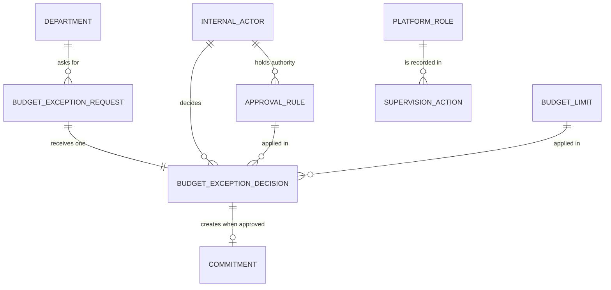

# 0032 — Phase 1 Database Architecture

**Status:** APPROVED  
**Date:** 2026-11-17  
**Approved by:** Project owner (Q-026, recorded 2026-11-17)

---

## Context

Phase 1 needs a database for accounts, sessions, the organization MONUMENT, memberships and the four business roles (`06-ROADMAP.md`, section 4). The data of one organization must never be visible to another, because `05-TECHNICAL-ARCHITECTURE.md`, section 10, and ADR 0010 require isolation from the first implementation. A database design was not yet approved. The draft schema on branch `feat/phase-1-backend-foundation` was written before any architecture decision and is on hold.

The detailed design is in `docs/database/phase-1-database-architecture.md`. This record holds the decision. The membership rules (history, one active organization per account) are decided separately in ADR 0033.

## Alternatives

1. **Alternative A: shared schema, `organization_id` on organization-owned tables, isolation enforced by keys, backend rules and tests.** Advantages: simplest to build and read; one database role; works on any PostgreSQL version. Disadvantages: the database cannot refuse a cross-organization read, so a forgotten filter shows as wrong data. Impact: small. Cost: R$ 0 per month. Maintenance: low now, higher later, because each new query must be reviewed for the filter.
2. **Alternative B: Alternative A, plus PostgreSQL row-level security (RLS) with two database roles and per-transaction context.** Advantages: the database blocks a cross-organization read or write even when the application forgets a filter; still one database, one schema and one migration path. Disadvantages: each organization-owned table needs policies and tests; every connection and background job must set the transaction context; errors look like empty results and need an explicit check. Impact: medium (connection and transaction layer, two roles created once per machine). Cost: R$ 0 per month (a PostgreSQL feature; needs PostgreSQL 9.5 or later). Maintenance: moderate.
3. **Alternative C: one PostgreSQL schema (or database) per organization.** Advantages: strongest structural separation. Disadvantages: migrations, seeds, backups and tests multiply with each organization; cross-organization features (Phase 8) become harder. Impact: high. Cost: R$ 0 on the phone for a few organizations, rising with their number. Maintenance: high.

## Decision

The Phase 1 database uses **Alternative B**:

1. **One PostgreSQL database and one schema** for all organizations. Every organization-owned table has `organization_id NOT NULL`. Identity tables (`user`, `session`, `account`, `verification`) and the catalogs (`roles`, `permissions`, `role_permissions`) are global.
2. **Row-level security** is enabled and forced on organization-owned tables. The policies compare each row's `organization_id` with the transaction setting `app.organization_id`. When the setting is missing, no row matches (fail closed).
3. **Two database roles.** `expathio_owner` owns the tables and runs migrations and the seed. `expathio_app` runs the application, the workers and the tests. It is not the owner and has no `BYPASSRLS`. The application never connects as the owner.
4. **Transaction context.** Each organization-scoped transaction sets `app.organization_id` and `app.user_id` with `set_config(..., true)`, so the setting lasts only for that transaction. Background jobs set the same values from their payload. Permission checks in later phases also use `app.role_key`.
5. **Keys and backend rules remain.** Composite foreign keys that include `organization_id` are used from Phase 2 on. The backend takes the organization from the authenticated membership, never from the request body. The database layer refuses an organization-scoped query when no organization is set.
6. **Permissions are data, changed only through a versioned file** (`shared/access-rules.ts`) and a deployment, until Phase 2. An idempotent seed loads them into `permissions` and `role_permissions`. An integration test checks that the rows equal the file.
7. **Migrations** are SQL files generated by Drizzle Kit, versioned in Git, applied by the deployment script before the application restarts. Migration files are never edited after they have been applied. Row-level security and the role grants are written in migration files.
8. **Tests** run against PostgreSQL in Docker (ADR 0016), built from the migration files and run as `expathio_app`. They cover the isolation rules (no context, cross-organization read and write, context leak between pooled connections, owner subject to the rules) and the membership rules.
9. **Test accounts and reference data are on the phone** (owner decision Q-031). Passwords are never stored in the repository or in plain text on the phone.
10. **Identifiers.** Our tables use `uuid` keys generated by the application. Times are `timestamptz`. E-mail is unique without regard to case.

**Not decided by this record, and not blocking the decision:**

- The PostgreSQL and Node.js versions on the phone (Q-007). Implementation and the Docker image pin depend on it. RLS needs PostgreSQL 9.5 or later.
- The procedure to create the two database roles on each machine (Infrastructure and Operations).
- The action names `read`, `change`, `request` and `decide`, which Product will propose (Q-029). They affect only the permission rows of the seed.
- Customer data visibility (Q-030), which applies from Phase 2, and the glossary terms (Q-033). These are documentation decisions.

## Rationale

- The owner asked not to limit the choice by complexity, and to choose the option where the database itself enforces isolation (Q-026).
- A missing filter in the application is blocked by the database under Alternative B, and only found by tests under Alternative A.
- It costs nothing in software, and it uses one database, which fits the modular monolith (`05`, section 3) and the single phone (ADR 0011).
- Alternative C was rejected for Phase 1: it multiplies migrations and backups for a single organization, and it works against the shared-database model that ADR 0010 and `05`, section 10, describe.

## Consequences

- Phase 1 implementation (the Platform Engineering session) rebuilds the draft schema as described in the detailed design, section 12, and regenerates its migration. The draft branch `feat/phase-1-backend-foundation` stays on hold until then.
- Each new organization-owned table, from Phase 2, needs a row-level security policy, an index starting with `organization_id`, and isolation tests.
- The deployment script must apply migrations as `expathio_owner` and start the application as `expathio_app`. The script and the role setup belong to Infrastructure and Operations (ADR 0016).
- Rollback still relies on the daily backup or a hand-written reverse migration, because Drizzle does not generate reverse migrations (ADR 0016; Q-009).
- Implementation is blocked until Q-007 is answered and the role-creation procedure exists. The decision is not blocked.
- Membership rules are decided separately in ADR 0033 (2026-11-17): one active occupant per role per organization (ADR 0007), one active membership per account at a time in one organization (Q-041), and membership history from Phase 1 (Q-032).
- The cost is R$ 0 per month for Phase 1. The cost of Phase 4 hosting is not decided here (Q-006).
- Business-level text about the rule is a Product and Documentation matter (`08-COMPANY.md`). No change to that file is made by this record.

## Amendment 1 (approved 2026-11-17)

**Approved by:** Project owner, 2026-11-17, as relayed by Product and Documentation. This amendment adds to the record above; it does not replace it. The decisions 1 to 10 stay as they are.

**Why:** ADR 0036 (Phase 1 financial structure, 2026-11-17) adds capital, cash, budget and commitment data to Phase 1, and says this record must be amended to cover it.

**What is added to Phase 1.** All of these are organization-owned, with row-level security under decisions 2 to 8:

- `departments`: the eight departments of `08-COMPANY.md`, section 4, with the minimum scope set by the owner (Q-044). They exist only to attach budget limits. No hierarchy, no full structure and no administrative functions (Phase 2).
- `capital_contributions`: each contribution of capital, with the label of the bank account it went to. Append-only.
- `cash_ledger_entries`: the one cash balance of the company, as signed entries. Append-only.
- `budget_limits`: a limit per department, effective from a date. Append-only. (Amendment 2 sets the date to a calendar month.)
- `commitments`: amounts committed to a department, with status `open` or `released`. (Amendment 2 adds the status `converted` and a link to the decision.)

Money is stored as integer minor units (`bigint`) in `BRL`. The available balance and the committed amounts are queries, not stored balances. The design is in `docs/database/phase-1-database-architecture.md`, section 17.

**Not in this amendment.** The budget exception tables (requests, decisions, approval rules, the internal actor that decides, and the owner's and administrator's oversight records). These are in Amendment 2.

## Amendment 2 (approved 2026-11-17)

**Status:** APPROVED.  
**Approved by:** Project owner, 2026-11-17, as relayed by Product and Documentation, on the scope of this section. This amendment adds to the record above and does not replace it. The decisions 1 to 10 stay as they are.

**Why:** ADR 0036 (decision 1) puts the budget exception flow in Phase 1: a request with justification, an evaluation by fixed rules of the simulated management, an approval or rejection, and an audit record. The owner's answers of 2026-11-17 set the authority (Q-046), the supervision access (Q-047), the status of the simulated manager (Q-048), the monthly budget period (Q-042), the definition of available (Q-043), the commitment on approval (Q-049), and the administrator role (Q-050). Amendment 1 does not cover the exception tables.

**Clarifications and changes to Amendment 1, made by this amendment:**

- `budget_limits`: the effective date is the first day of a calendar month (`period_month`). A limit covers one month, and an unused amount does not carry over to the next month (Q-042). One limit per department per month. Exceptions to the monthly period are for a later version.
- `commitments`: the status is `open`, `converted` or `released`. A commitment is created by an approved exception, with a reference to its decision (`source_decision_id`).

**What is added (all organization-owned, under decisions 2 to 8 of this record, unless marked global):**

- `internal_actors`: an internal actor of the organization, of kind `simulated_manager` in Phase 1. It is not a participant role, not a user account, and not an AI agent (Q-048). Decisions are recorded under its identity.
- `approval_rules`: the business authority of an actor, by action (`approve_budget_exception`), a maximum amount, and optionally one department. A new version is a new row (append-only). Rules are data, evaluated by the application in a fixed order; no model is involved.
- `budget_exception_requests`: a request, with department, amount, justification (required, not empty) and the requesting account. Append-only.
- `budget_exception_decisions`: one row per request, with the outcome (`approved` or `rejected`), a reason code, the rule version used, the internal actor that decided, the budget limit that applied, snapshots of the available amount and of the department's committed amount at decision time, and the amount available after the decision. Append-only. One decision per request.
- `platform_roles` (global, not organization-owned): the owner and the administrator, with the grant record. The owner is the only one who grants or revokes a role (Q-050). The first version has one owner and at most one additional administrator. The administrator cannot grant its own role or appoint other administrators. Enforced by a unique rule on the active administrator, and by the grant path, which accepts only the owner.
- `supervision_actions` (global, not organization-owned): an identified record of each action taken by the owner or administrator, including grants and revocations, with actor, action, target and time. Append-only. Written only through one logged function.

**Evaluation order (fixed, deterministic):**

1. The justification is not empty.
2. An active rule for the actor and the action exists, and the amount is within its maximum.
3. The department's available amount covers the requested amount. Available is defined as: the limit of the month, minus the realized spending of the department, minus its committed amount (Q-043). In Phase 1 realized spending is zero, because no purchase exists.
4. The budget limit applied is the one of the month of the decision date (Q-042).

Any failed check is a rejection with its reason code. Nothing is approved by default, and nothing is approved silently.

**Commitment lifecycle (Q-049):**

- An approved exception creates one commitment with status `open`. The approved amount is not available to other purchases while it is open.
- When a purchase exists (Phase 3), the commitment becomes spending: its status changes to `converted` and the spending refers to it, so the amount is counted once.
- Cancellation or expiry releases the amount: the status changes to `released`.
- Committed amount = sum of commitments with status `open`. Converted and released amounts are not counted as committed.
- The expiry rule (how long a commitment stays open) is not defined by the answers. It is open (Q-052).

**Demonstration:** `docs/database/phase-1-exception-entities.svg`, and the diagram below.

**Consequences if approved:**

- Phase 1 includes the six tables above, and the changes to `budget_limits` and `commitments`, in the database design. The Platform Engineering rebuild (ADR 0032, section 12) includes them.
- Tests for the flow run without any purchase: every request gets one decision; an amount above the maximum is rejected with its reason; an ended or missing rule rejects; decisions and rules cannot be changed; snapshots match the balances at decision time; an approved exception creates one open commitment; cancellation or expiry releases it; the outcome does not depend on any model.
- Only the owner grants or revokes the administrator role. A second administrator, or an administrator granting a role, is refused.
- Open points that the tables depend on, not decided here: the expiry rule of a commitment (Q-052); whether the company's available balance also caps the decision (Q-051).
- No change to the decisions 1 to 10 of this record.
